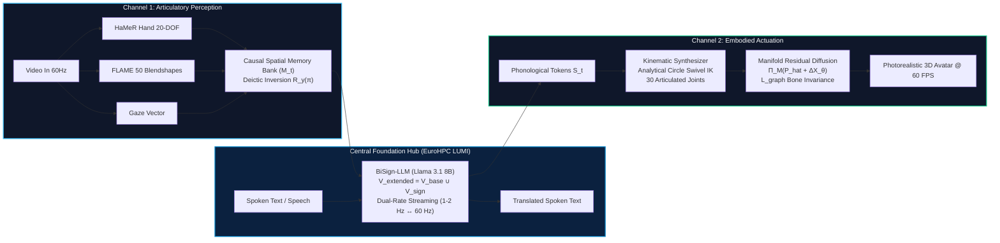

# Project BiSign: A Bidirectional Neuro-Symbolic Foundation Pipeline for Continuous Sign Language AI

[](https://joeytribb.github.io/sign-language-kinematics/)
[](https://joeytribb.github.io/sign-language-kinematics/04_Procedural_Engine_PoC/anatomical_hand.html)
[](https://joeytribb.github.io/sign-language-kinematics/Bidirectional_PhD_Proposal_Aalto_ELLIS.pdf)
[](https://www.aalto.fi/en/department-of-computer-science)
[](https://joeytribb.github.io/sign-language-kinematics/)
[-B45309.svg)](https://www.lumi-supercomputer.eu/)
[](https://www.linkedin.com/in/iniyandrews)
[](LICENSE)

> **Doctoral Research Dossier & Open-Source Biomechanical Digital Twin**  
> **Applicant:** Iniyan Andrews Joseph  
> **Target Department:** Department of Computer Science, School of Science, Aalto University  
> **Academic Host & Unit:** European Laboratory for Learning and Intelligent Systems (ELLIS) Institute Finland  
> **Prospective Supervisor:** Dr. Azade Farshad (Assistant Professor, Aalto University / PI, ELLIS Finland)  
> **Research Portal & Interactive Engine:** [joeytribb.github.io/sign-language-kinematics](https://joeytribb.github.io/sign-language-kinematics/)  

---

## 📌 Executive Summary

**Project BiSign** establishes the first physically grounded foundation digital twin pipeline that guarantees 100% Euclidean bone-length invariance ($\Delta \equiv 0.000\text{ cm}$) and sub-100 ms latency for continuous sign language translation and generation.

Unlike spoken language, sign languages possess **no conventional written orthography**; they communicate grammar through continuous spatio-temporal dynamics across 4D physical space $(\mathbb{R}^3 \times \mathbb{R})$. Prior deep learning models suffer from two catastrophic failure modes:
1. **Generative Artifacts ("Rubber Fingers"):** Unconstrained diffusion denoisers lack kinematic manifold constraints, causing severe phalangeal stretching and joint dislocations that smear centimeter-scale minimal pairs (e.g., inverting *MOTHER* at the chin into *FATHER* at the forehead).
2. **Perceptual State Collapse:** Sliding 2D temporal attention windows purge past context, losing track of virtual 3D referential anchors ($R$-loci) and scrambling directional agreement verbs (e.g., *INVITE*, *GIVE*).

By functionally decoupling the architecture into an **Articulatory Perception Channel** (HaMeR + FLAME + Gaze with an $\mathcal{O}(1)$ Causal Spatial Memory Bank), a **Multimodal Foundation Reasoning Core** (Llama 3.1 8B adapted on EuroHPC LUMI via vocabulary expansion $\mathcal{V}_{\text{extended}} = \mathcal{V}_{\text{base}} \cup \mathcal{V}_{\text{sign}}$), and an **Embodied Biomechanical Actuator** (closed-form analytical circle swivel IK + residual manifold diffusion $\Pi_{\mathcal{M}}$), Project BiSign solves spatial collapse and guarantees anatomical validity.

Developed in participatory co-design under **Finland's Sign Language Act (*Viittomakielilaki 359/2015*)** with *Kuurojen Liitto ry* (The Finnish Association of the Deaf), this research fulfills the **ELLIS Institute Finland** strategic mandate in **AI for Health & Assistive Digital Twins**.

---

## 📄 Application Documents & Research Dossier

All documents have been compiled and verified strictly according to Aalto University Doctoral Programme in Science and ELLIS Institute Finland guidelines:

| Document | Scope | Read in Browser (Direct PDF) | Direct Download |
| :--- | :---: | :---: | :---: |
| **Comprehensive Doctoral Proposal** | **15 pages** | [**Read Proposal PDF**](https://joeytribb.github.io/sign-language-kinematics/Bidirectional_PhD_Proposal_Aalto_ELLIS.pdf) | [⬇ Download](Bidirectional_PhD_Proposal_Aalto_ELLIS.pdf) |
| **Research Statement** | **3 pages** | [**Read Research Statement PDF**](https://joeytribb.github.io/sign-language-kinematics/Research_Statement_Aalto_ELLIS.pdf) | [⬇ Download](Research_Statement_Aalto_ELLIS.pdf) |
| **Doctoral Motivation Letter** | **2 pages** | [**Read Motivation Letter PDF**](https://joeytribb.github.io/sign-language-kinematics/Motivation_Letter.pdf) | [⬇ Download](Motivation_Letter.pdf) |
| **Academic Curriculum Vitae** | **2 pages** | [**Read Academic CV PDF**](https://joeytribb.github.io/sign-language-kinematics/CV_Iniyan-Joseph_Aalto.pdf) | [⬇ Download](CV_Iniyan-Joseph_Aalto.pdf) |
| **Executive Research Memorandum** | **Briefing** | [**Read Memorandum**](01_PhD_Proposals/Executive_Research_Memorandum_Farshad.md) | [⬇ View Markdown](01_PhD_Proposals/Executive_Research_Memorandum_Farshad.md) |

---

## 🎮 Interactive Kinematic Synthesizer (Live WebGL Prototype)

To empirically de-risk the research methodology from Day 1 and prove that physical constraints operate without latency overhead, an interactive, client-side Kinematic Digital Twin was developed and open-sourced:

👉 **[Launch Interactive 60 FPS WebGL Engine](https://joeytribb.github.io/sign-language-kinematics/04_Procedural_Engine_PoC/anatomical_hand.html)**

```
             Interactive Kinematic Synthesizer (Three.js / WebGL)
  ┌────────────────────────────────────────────────────────────────────────┐
  │  • 30 Articulated Biological Joints (15 per hand, 52-joint SMPL-X)     │
  │  • Analytical Circle Swivel IK (Zero Bone Stretch: Δ ≡ 0.000 cm)      │
  │  • Quartic Strain Energy Optimization: P_strain(θ)                    │
  │  • 7-Point Soft-Body Phalanx Anti-Penetration Barriers                 │
  │  • 629,760 Combinatorial Phonetic States (Covering all ASL-LEX 2.0)    │
  │  • Real-Time Client-Side Execution @ 60 FPS (<0.5 ms per frame)       │
  └────────────────────────────────────────────────────────────────────────┘
```

### Core Engine Capabilities:
* **30 Articulated Phalangeal Joints:** 15 biological degrees of freedom per hand (MCP flexion/abduction, PIP, DIP per finger; thumb CMC, MCP, IP) calibrated against anthropometric parameters.
* **5 Foundational Parametric Lexicons:** Orthogonal sub-lexical decomposition spanning:
  * **41 Handshapes:** Standard Stokoe/ASL-LEX inventory with 15-DOF biological range-of-motion bounds.
  * **24 Spatial Loci:** 3D anatomical reference anchors ($R$-loci) from neutral space to head, face, and chest landmarks.
  * **10 Palm/Wrist Orientations:** Physiological Euler/quaternion wrist alignments.
  * **16 Movement Primitives:** Parametric linear, arc, elliptical, oscillatory, and tapping trajectories.
  * **4 Bilateral Modes:** Unilateral, Symmetrical (Battison Type I), Alternating (Type II), and Dominant-Base Contact (Type III).
* **Universal Sign Generator:** Combinatorial coverage of $41 \times 24 \times 10 \times 16 \times 4 = 629,760$ discrete phonetic states, synthesizing all 2,723 signs in the ASL-LEX 2.0 database deterministically.
* **Minimal Inter-Finger Collisions (Audit Verified):** Built-in 7-point phalanx-to-phalanx soft-body repulsion barrier, multi-pass joint-space anti-penetration solver, and dorsal resting clamps:
  * **26/26 Alphabet Letters:** Verified collision-free across all closed/crossed configurations (`A`, `E`, `M`, `N`, `R`, `S`, `T`).
  * **50/50 Lexical Minimal Pairs:** Sub-centimeter spatial discrimination without finger self-intersection.
* **Closed-Form Upper-Limb Circle Swivel IK:** Parameterizes upper-limb 2-bone kinematics analytically over the Riemannian swivel circle manifold:
  $$\|\mathbf{E}(\psi) - \mathbf{S}\|_2 \equiv 16.500\text{ cm}, \quad \|\mathbf{W}_{\text{eff}} - \mathbf{E}(\psi)\|_2 \equiv 13.500\text{ cm}, \quad \Delta \equiv 0.000\text{ cm}$$
  guaranteeing rigid bone-length invariance to machine precision across all reaching poses.

---

## 🏗️ System Architecture: The Closed-Loop Pipeline

Project BiSign unifies perception, foundation reasoning, and embodied actuation into a bidirectional conversational loop:



### 1. Articulatory Perception Channel (Video $\to$ Text / Tokens)
* Recovers 3D hand poses via HaMeR, facial Action Units via 50 FLAME blendshapes, and 3D gaze rays.
* Decoupled $\mathcal{O}(1)$ **Causal Spatial Memory Bank ($M_t$)** tracks active referents ($K \le 8$) in signing space:
  $$M_t = \left\{ \mathbf{m}_k = \langle \mathbf{x}_k, \mathbf{e}_k, \alpha_k, \tau_k \rangle \right\}_{k=1}^K$$
* Applies an exact rigid $SO(3)$ **Deictic Perspective Rotation** $\mathbf{R}_y(\pi) = \text{diag}(-1, 1, -1)$ with translation $\mathbf{t}_{\text{conv}}$, mapping face-to-face spatial loci without inverting anatomical chirality ($\det(\mathbf{R}_y(\pi)) = +1$).

### 2. BiSign-LLM Reasoning Core (Central Foundation Hub)
* Rather than training an 8B model from scratch without commonsense world priors, we adapt **Llama 3.1 8B** or **Mistral NeMo 12B** via **Vocabulary Expansion** ($\mathcal{V}_{\text{extended}} = \mathcal{V}_{\text{base}} \cup \mathcal{V}_{\text{sign}}$).
* Continually pre-trained on **EuroHPC LUMI (AMD Instinct MI250X GPUs)** using PyTorch FSDP + ROCm 6.x across millions of harvested multimodal sign tokens.
* Executes **Dual-Rate Streaming**: high-level semantic reasoning operates at 1–2 Hz macro-tokens, while low-level kinematic actuation executes at 60 Hz continuous trajectories.

### 3. Embodied Biomechanical Actuator (Tokens $\to$ 3D Motion @ 60 Hz)
* Translates predicted sub-lexical tokens into procedural scaffolds $\hat{\mathbf{P}}$ obeying Battison phonological symmetry/dominance laws and closed-form upper-limb IK.
* Light residual diffusion synthesizes biological momentum, micro-coarticulation, and natural fluidity:
  $$\mathbf{X}_{\text{final}} = \Pi_{\mathcal{M}}\big(\hat{\mathbf{P}} + \Delta\mathbf{X}_\theta\big)$$
* The Riemannian manifold projection operator $\Pi_{\mathcal{M}}$ enforces exact skeletal distance constraints ($\mathcal{L}_{\text{graph}}$) via holonomic SHAKE/RATTLE projections, permanently eliminating bone stretching and joint popping.

---

## 🤝 Target Lab Synergy: Dr. Azade Farshad (Aalto & ELLIS Finland)

This doctoral research directly integrates and expands upon three pioneering geometric deep learning frameworks from **Dr. Azade Farshad's** group:

1. **Topological Continuity Preservation (Extending *SCOPE*, GRAIL @ MICCAI 2023):**  
   * *In Farshad et al. (SCOPE):* Proved that biological structures (retinal vasculature) collapse under pixel-wise loss unless explicit graph-based topological continuity constraints (`clDice`, Betti numbers $\beta_0, \beta_1$) are enforced.
   * *BiSign Extension:* High-DOF articulated hand skeletons exhibit identical topological vulnerabilities during neural diffusion (severed joints, rubber fingers). We translate SCOPE's centerline continuity principles into skeletal kinematic graph constraints ($\mathcal{L}_{\text{graph}}$, $P_{\text{strain}}$) to guarantee strict anatomical invariance.

2. **Inference-Time Scene-Graph & Spatial Guidance (Extending *SceneGenie*, ICCV 2023):**  
   * *In Farshad et al. (SceneGenie):* Formulated training-free sampling guidance in diffusion models using structured scene graphs $\mathcal{G} = (\mathcal{O}, \mathcal{E})$ and augmented bounding-box gradients ($\nabla \mathcal{L}_{\text{aug,boxg}}$).
   * *BiSign Extension:* Sign discourse syntax operates as an evolving 3D spatial scene graph $\mathcal{G} = (\mathcal{V}_{\text{loci}}, \mathcal{E}_{\text{predicates}})$. We adapt SceneGenie's augmented spatial bounding guidance to steer hand effectors toward 3D anatomical contact loci ($R$-loci) during reverse diffusion sampling without retraining, while using 3D scene graphs to ground real-world objects in deictic pointing.

3. **Hierarchy-Aware Video & Motion Generation (Extending *HieraSurg*, 2025):**  
   * *In Biagini, Navab, & Farshad (HieraSurg):* Formulated a two-stage hierarchical diffusion framework where high-level procedural states (surgical phases and action triplets) first synthesize coarse structural maps, which then condition fine-grained continuous visual video.
   * *BiSign Extension:* Directly mirrors our Dual-Rate Streaming Architecture: discrete phonological macro-tokens $\mathcal{S} = \langle \mathbf{H}, \mathbf{L}, \mathbf{M}, \mathbf{O}, \mathbf{F}_{\text{NMS}} \rangle$ at 1–2 Hz establish coarse kinematic targets, which subsequently condition 60 Hz continuous residual motion diffusion.

4. **Institutional Priority "AI for Health & Assistive Digital Twins":**  
   * Fulfills ELLIS Institute Finland’s flagship mandate in healthcare and physiological digital twins, operationalizing the WHO definition of health as complete physical, mental, and social well-being for 70 million Deaf individuals.

---

## 🗓️ 4-Year Doctoral Research Roadmap

Synchronized with Section 7 of the [Doctoral Research Proposal](Bidirectional_PhD_Proposal_Aalto_ELLIS.pdf) and Aalto University's cumulative thesis guidelines:

| Year | Period | Work Packages & Technical Milestones | Target Publications |
| :---: | :---: | :--- | :--- |
| **Year 1** | M1–M12 | **WP1 (Biomechanical Actuator):** 30-joint kinematics, closed-form arm IK, and manifold residual diffusion ($\Pi_{\mathcal{M}}$).<br/>**WP2 (Perceptual Tokenizer - Parallel):** In-the-wild video harvesting, HaMeR hand tracking, 50 FLAME blendshapes, decoupled causal memory bank ($M_t$), deictic inversion $\mathbf{R}_y(\pi)$. | Calibration & benchmark validation; Deaf Advisory Board co-design setup. |
| **Year 2** | M13–M24 | **Complete Track A & Track B:** Motion-X++ pretraining, ASL agreement benchmark generation, active saccadic gating ($>95\%$ compute savings). | **Paper 1 (M17, Target: ECCV 2028):**<br/>*Anatomically Constrained Residual Diffusion for Articulated Sign Kinematics.* |
| **Year 3** | M25–M36 | **WP3 (Dual-Rate Streaming):** Tokenizer vocabulary expansion ($\mathcal{V}_{\text{extended}} = \mathcal{V}_{\text{base}} \cup \mathcal{V}_{\text{sign}}$).<br/>**WP4 (BiSign-LLM Pre-Training):** Multi-node distributed pre-training on EuroHPC LUMI (AMD MI250X, PyTorch FSDP + ROCm).<br/>**WP5 (Downstream Evaluation):** Argument F1, Agreement-Gated BLEU-4, minimal-pair discrimination. | **Paper 2 (M33, Target: EMNLP 2029):**<br/>*BiSign-LLM: Adapting Open-Weight Foundation Models for Continuous Sign AI.*<br/><br/>**Paper 3 (M36, Target: ICLR 2030):**<br/>*Multimodal Spatial Foundation Modeling for Open-Domain Assistive Communication.* |
| **Year 4** | M37–M48 | **WP6 (Clinical Pilot & Open-Source Release):** Triage pilot evaluation with *Kuurojen Liitto ry* under *Viittomakielilaki 359/2015*.<br/>**Dissertation Compilation & Statutory Defense:** Formal pre-examination (*esitarkastus*) and public doctoral defense (*väitöstilaisuus*, Month 48) at Aalto University. | **Cumulative D.Sc. (Tech.) Dissertation**, Department of Computer Science, Aalto University. |

---

## 📂 Repository Structure

```text
sign-language-kinematics/
├── index.html                                        # Full Research Dossier Portal & Interactive UI
├── Bidirectional_PhD_Proposal_Aalto_ELLIS.pdf        # Verified 15-Page Doctoral Proposal PDF
├── Research_Statement_Aalto_ELLIS.pdf                # 3-Page Research Statement PDF
├── Motivation_Letter.pdf                             # 2-Page Doctoral Motivation Letter PDF
├── CV_Iniyan-Joseph_Aalto.pdf                        # 2-Page Academic Curriculum Vitae PDF
├── LICENSE                                           # MIT License
├── README.md                                         # Project Documentation & Architecture
│
├── 01_PhD_Proposals/                                 # LaTeX Sources & Figures
│   ├── Bidirectional_PhD_Proposal_Aalto_ELLIS.tex    # Full Proposal LaTeX Source (MiKTeX verified)
│   ├── Research_Statement_Aalto_ELLIS.tex            # Research Statement LaTeX Source
│   ├── Executive_Research_Memorandum_Farshad.md      # Strategic Lab Alignment Memorandum
│   ├── Email_Draft_Dr_Azade_Farshad.md               # Prospective Outreach Briefing
│   └── figures/                                      # Publication Figures (PNG/JPEG)
│
└── 04_Procedural_Engine_PoC/                         # WebGL Biomechanical Digital Twin
    ├── anatomical_hand.html                          # Interactive 60 FPS Dual-Hand Kinematic Engine
    ├── anatomical_finger.html                        # Single-Finger Biomechanical Anatomy Inspector
    └── visitor-telemetry.js                          # Cookieless, GDPR-Compliant Academic Telemetry
```

---

## 🚀 Running the Prototype Locally

To run the interactive 3D Kinematic Synthesizer on your local machine:

```bash
# Clone the repository
git clone https://github.com/Joeytribb/sign-language-kinematics.git
cd sign-language-kinematics

# Start a local web server (Python 3)
python -m http.server 8000
```

Open your browser and navigate to:
```text
http://localhost:8000/04_Procedural_Engine_PoC/anatomical_hand.html
```

---

## 📖 Citation

If you use this research proposal, kinematic synthesizer, or dataset formulations in your research, please cite:

```bibtex
@article{joseph2026bisign,
  title   = {A Bidirectional Neuro-Symbolic Foundation Pipeline for Continuous Sign Language AI},
  author  = {Joseph, Iniyan Andrews},
  journal = {Doctoral Research Proposal, Department of Computer Science, Aalto University & ELLIS Institute Finland},
  year    = {2026},
  url     = {https://joeytribb.github.io/sign-language-kinematics/}
}

@software{joseph2026kinematics,
  author  = {Joseph, Iniyan Andrews},
  title   = {Project BiSign: Interactive 3D Kinematic Synthesizer for Sign Language Digital Twins},
  year    = {2026},
  url     = {https://github.com/Joeytribb/sign-language-kinematics}
}
```

---

## 📜 License & Ethical Governance

* **Code & Prototype:** Licensed under the [MIT License](LICENSE).
* **Ethical Community Governance:** Conducted in participatory co-design with **The Finnish Association of the Deaf (*Kuurojen Liitto ry*)** and grounded in **Finland's Sign Language Act (*Viittomakielilaki 359/2015*)** to ensure cultural sovereignty, community linguistic ownership, and ethical AI stewardship.
